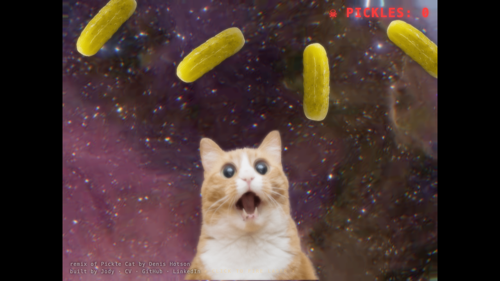

# Pickle Cat — Laser Edition

A small browser game: a mesmerized cat shoots lasers from its eyes at drifting pickles. Click to fire; every pickle you hit explodes and adds to the counter.



**Play it:** https://jodyvanden.github.io/pickel-cat-laser/

## Controls

- **Click / tap** — fire lasers from both eyes at the cursor
- **Mouse** — the cat's displacement effect follows your pointer
- Music starts on your first click (browsers block autoplay)

## Run locally

The game loads images over HTTP, which browsers block from `file://`, so it needs a tiny static file server:

```sh
./start_server.sh        # serves on http://localhost:8000 and opens the page
```

or `python3 -m http.server` and open `http://localhost:8000/`. No build step, no dependencies to install.

## Tests

The logic that can be tested without a browser lives in small modules with plain Node tests (Node 18+):

```sh
node --test test/eyes.test.js test/layout.test.js test/pickles.test.js
```

| Module       | What it does                                                        |
| ------------ | ------------------------------------------------------------------- |
| `eyes.js`    | Where the lasers start, locked to the cat's eyes as it wobbles      |
| `layout.js`  | Fits the 1024×768 canvas to any window, keeping the aspect ratio    |
| `pickles.js` | Evenly spaced pickle motion, so they never bunch up                 |

## How it works

Rendered with [PixiJS](https://pixijs.com/) v3: a displacement filter and RGB split warp the space background, the cat has its own displacement map, and the stage gets a bloom pass. Lasers, particles and explosions are drawn with `PIXI.Graphics`. Everything runs client-side, so it is hosted as a static site on GitHub Pages.

## Credits

- Remix of [Pickle Cat](https://dn.ht/picklecat/) by Denis Hotson.
- Music: "Interstellar" by Lazerhawk.
- Built by Jody Vandenschrick — [CV](https://jodyvanden.github.io/cv/) · [GitHub](https://github.com/jodyvanden) · [LinkedIn](https://www.linkedin.com/in/jodyvandenschrick)
